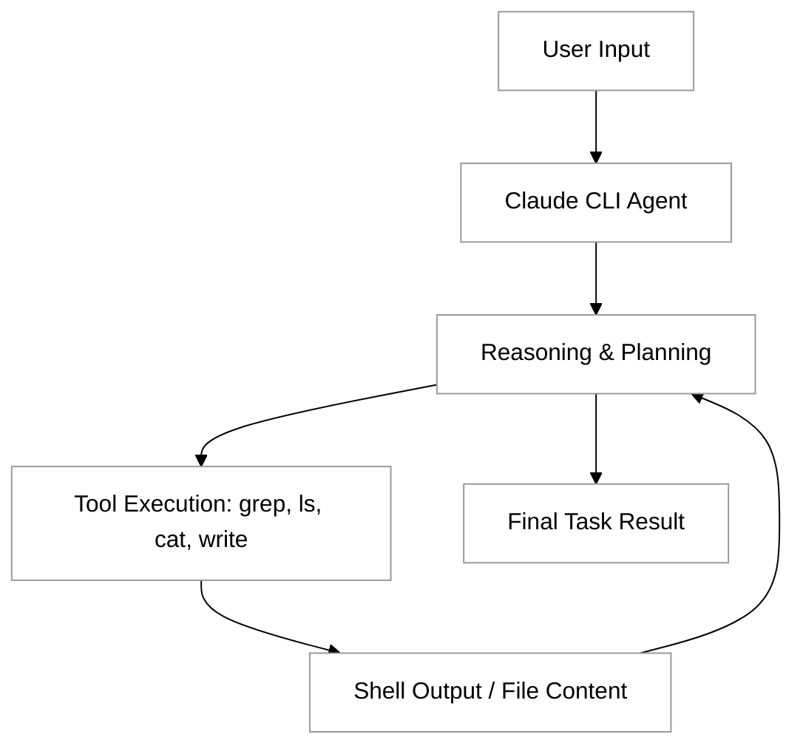
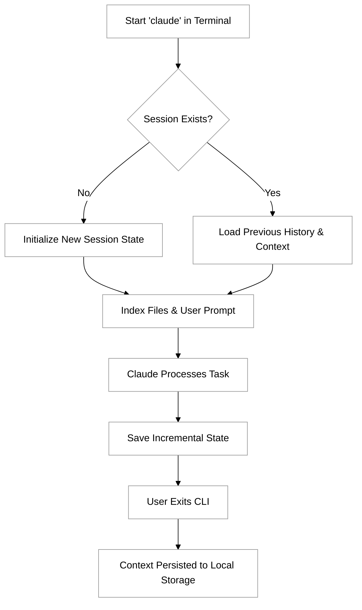

# Claude CLI

The Claude CLI, specifically the agentic tool known as **Claude Code**, represents a significant shift in how developers interact with Large Language Models (LLMs). While traditional web interfaces restrict the model to a sandbox, the Claude CLI operates directly within your terminal, allowing the model to interact with your local file system, execute shell commands, and manage git repositories. It serves as a primary example of an agentic system in action: it doesn't just suggest code; it performs actions, observes the results, and iterates until a goal is met.

By integrating the reasoning capabilities of Claude 3.5 Sonnet with a set of powerful local tools, the CLI transforms the model from a passive advisor into an active collaborator. This tool is built upon the principles of the Model Context Protocol (MCP), enabling it to navigate complex codebases and perform multi-step engineering tasks that would be tedious or impossible via manual copy-pasting.

## Core Capabilities and Architecture

The Claude CLI is designed to function as a "loops-based" agent. When you provide a high-level instruction—such as "Refactor this project to use TypeScript"—the CLI initiates a cycle of planning and execution. It uses specialized tools to list files, read their contents, search for specific patterns, and write updates.



This architecture allows the model to self-correct. If Claude attempts to run a test and it fails, the CLI captures the error output, analyzes the failure, and attempts a fix—all without manual intervention from the developer.

## Installation and Setup

To get started with the Claude CLI, you need a development environment with Node.js installed. Since the tool interacts with your local system, it is recommended to run it within projects that are tracked by version control (Git) so you can easily review and revert changes.

Install the CLI globally using npm:

```bash
npm install -g @anthropic-ai/claude-code
```

Once installed, you can launch the interface by typing `claude` in your terminal. On the first run, the tool will guide you through an authentication process via your Anthropic Console account. You will need a valid API key with sufficient credits or a billing plan, as the CLI consumes tokens for both reasoning and the context provided by your files.


## Essential Commands for Claude Code

Claude Code is an agentic CLI tool that allows you to interact with your codebase using natural language. While much of your interaction will involve simply describing what you want to achieve, the CLI provides a suite of "slash commands" and flags to manage the session, optimize token usage, and control how Claude interacts with your files.

### Starting the Session
The primary entry point is the `claude` command. When executed in a terminal within your project directory, it initializes the environment and indexes your files (respecting your `.gitignore`).

*   `claude`: Starts an interactive session.
*   `claude "your prompt"`: Executes a one-off task and exits.
*   `claude --danger`: Runs Claude in a mode that skips certain confirmation prompts for file writes (use with caution).
*   `claude config`: Opens the configuration menu to manage API keys, themes, and model settings.

### Interactive Slash Commands
Once inside the Claude Code shell, you can use specialized commands to manage the state of the conversation. These are prefixed with a forward slash (`/`).

| Command | Purpose |
| :--- | :--- |
| `/compact` | Compresses the conversation history to save on context window tokens while preserving key information. |
| `/undo` | Reverts the last set of changes made to the file system. |
| `/review` | Asks Claude to review the current changes or a specific file for potential bugs or style issues. |
| `/test` | Prompts Claude to generate or run tests for the current context. |
| `/clear` | Clears the current conversation history to start fresh without restarting the CLI. |
| `/help` | Displays a list of all available commands and their descriptions. |

### Practical Examples

**Example 1: Fixing a Bug**
If you have a known error in a React component, you can pipe the error log or simply describe it:
```bash
claude "I'm seeing a hydration error in Navbar.tsx, please fix it and run 'npm test'"
```

**Example 2: Managing Token Usage**
In long-running sessions, your "Context Window" can fill up, making responses slower or more expensive. Use the compact command regularly:
```text
Claude> /compact
# Claude will summarize the history and reduce the token count.
```

**Example 3: Undoing Mistakes**
If Claude suggests a refactor that breaks your build, you don't need to manually revert files via Git:
```text
Claude> /undo
# Claude reverts the last file changes it made during this session.
```

```masteryls
{"id":"28874792-5452-41a2-b0b4-489ca40aadd4","title":"Identifying Claude CLI Commands","type":"multiple-choice"}
Which slash command should you use if you want to revert the most recent file changes made by Claude during an interactive session?

- [ ] `/clear`
- [ ] `/compact`
- [x] `/undo`
- [ ] `/reset`
```


## Persisting Context and Session Management

Claude Code (the Claude CLI) is designed to function as a persistent stateful agent rather than a stateless prompt. When you initiate a session in a repository, Claude builds a mental model of your project structure, tracks your conversation history, and maintains a record of the changes it has proposed. This context is what allows Claude to understand complex instructions like "Fix the bug we discussed earlier in the utility file" without you needing to provide the file path again.

The CLI stores session data locally on your machine, typically within a hidden directory (e.g., `~/.claude/` or your OS-equivalent application data folder). This data includes the message history, tool execution results, and metadata about the files Claude has indexed. By persisting this context, Claude can resume a task exactly where it left off, even after you close your terminal or restart your computer.

### How Session Persistence Works

The following diagram illustrates the lifecycle of a Claude Code session and how the CLI interacts with the local state to maintain continuity.



### Best Practices for Context Management

To ensure Claude remains performant and accurate during long-running projects, follow these best practices for managing your session context:

1.  **Use `.claudeignore`**: Just like a `.gitignore` file, a `.claudeignore` file prevents the CLI from indexing unnecessary files (like `node_modules`, build artifacts, or large binaries). This keeps the "context window" clean and focused on your source code.
2.  **Clear Sessions Periodically**: If a session becomes too long, the context window may become saturated, leading to slower response times or decreased reasoning accuracy. You can start fresh by using specific flags or clearing the local cache.
3.  **Explicit File Mentioning**: Even though Claude tracks context, if you are working on a massive monorepo, explicitly mentioning the file you are interested in helps Claude prioritize that specific piece of context over others.

### Tutorial: Managing and Resuming Sessions

To effectively use session persistence, you should know how to start, resume, and manage your CLI environment.

**1. Starting a Session in a Specific Project**
Navigate to your project root and launch the CLI. Claude will detect the git root and begin building context.
```bash
cd ~/projects/my-web-app
claude
```

**2. Implementing a `.claudeignore`**
Create a file to prevent Claude from getting "distracted" by large logs or dependencies.
```text
# .claudeignore
node_modules/
dist/
*.log
.env
```

**3. Resuming Work**
If you exit the terminal and return later, simply running `claude` in the same directory will often prompt you or automatically reload the previous session state, allowing you to continue the conversation.

**4. Clearing State**
If you want to wipe the history and start with a "blank slate" for the project:
```bash
# Example of clearing session history (check specific CLI version help for exact command)
claude --clear
```

```masteryls
{"id":"b65e1ea5-4ff8-4d8f-b02c-e02e63895ae0","title":"Understanding CLI Persistence","type":"multiple-choice"}
Where does the Claude CLI primarily store the context and session history between interactions?

- [ ] It sends all history to the Anthropic cloud, and nothing is stored locally.
- [x] It stores session state in a local directory on your machine (e.g., ~/.claude/).
- [ ] It creates a hidden 'claude.log' file in every folder you visit.
- [ ] Context is lost the moment the terminal process is terminated.
```

## Practical Tutorial: Guided Code Exploration

One of the most powerful ways to use the Claude CLI is for "onboarding" yourself to a new or complex codebase. Instead of manually clicking through folders, you can ask the CLI to explain the architecture.

### Scenario: Understanding a New Project

1.  **Initialize**: Navigate to a directory you want to explore and run `claude`.
2.  **The Ask**: Type: `Summarize the architecture of this project and identify the main entry point.`
3.  **The Process**: You will see Claude execute `ls -R` to see the file structure, then `cat` on files like `package.json` or `main.py` to understand the dependencies and logic.
4.  **The Result**: Claude will provide a high-level overview of how data flows through the application.

### Scenario: Fixing a Bug

If you have a failing test, you can delegate the debugging process:

1.  **The Ask**: `I have a failing test in tests/auth.test.js. Find the root cause and fix it.`
2.  **The Process**: Claude will run the test command (e.g., `npm test`), capture the stack trace, search the codebase for the relevant function definitions, and apply a fix.
3.  **The Review**: Before finalizing, Claude will show you a diff of the changes. You can then ask it to run the tests again to verify the fix.

## Best Practices for Agentic Interaction

Using a CLI agent requires a different mindset than using a standard chatbot. Because the agent has "agency" over your files, clarity and constraints are vital.

**Be Specific with Scope**
While Claude can search your whole project, providing a starting point saves tokens and time. Use prompts like: "Focus only on the components in the `/src/ui` directory."

**Iterative Refinement**
Don't expect the agent to solve a massive architectural migration in one go. Break large tasks into smaller instructions. For example, instead of "Migrate the whole app to Tailwind," start with "Convert the Button component to use Tailwind CSS."

**Leverage Git Integration**
Always start your Claude sessions on a clean git branch. This allows you to use `git diff` to inspect every single character the agent changed. Claude CLI is specifically designed to work with git, often suggesting commit messages for the changes it makes.

## Challenges and Solutions

Working with a CLI agent involves unique hurdles, particularly regarding environment awareness and resource management.

*   **Context Window Management**: Large codebases can quickly overwhelm the model's context window. 
    *   *Solution*: Claude CLI uses sophisticated tools to search and "grep" only the relevant files rather than reading the entire repository at once. If it seems confused, try giving it the exact file path.
*   **Destructive Actions**: An agent might accidentally delete a file or overwrite critical logic if the instructions are ambiguous.
    *   *Solution*: Always review the tool outputs. The CLI typically asks for permission before executing major shell commands or writing changes. Never bypass these checks unless you are in a throwaway environment.
*   **Dependency Loops**: Sometimes an agent gets stuck in a loop trying to fix a dependency error that requires a manual configuration change (like an environment variable).
    *   *Solution*: If you see the agent repeating the same two steps, interrupt the process (Ctrl+C), provide the missing context manually, and then restart.

## Security Considerations

The Claude CLI operates with the permissions of the user running it. If you run the CLI as an administrator, the agent has administrative access to your machine. 

*   **Run in Trusted Environments**: Only use the CLI on codebases you trust.
*   **Monitor Shell Commands**: Be wary if the agent attempts to use `curl` or `wget` to download external scripts, or if it tries to access sensitive directories like `~/.ssh`.
*   **Read-Only Mode**: For exploration, you can often instruct the agent to "Analyze but do not modify any files" to ensure a safer experience.

## Summary

The Claude CLI represents the practical application of the Model Context Protocol, turning an LLM into a functional member of a development team. By mastering the installation, understanding the iterative reasoning loop, and following best practices for scoping and security, developers can significantly accelerate their workflows. Whether it is for routine refactoring, bug hunting, or architectural analysis, the CLI serves as a blueprint for how agentic tools will define the future of software engineering.

For further exploration, users are encouraged to investigate the [Anthropic MCP documentation](https://modelcontextprotocol.io) to see how they can extend these capabilities with custom tools and servers.