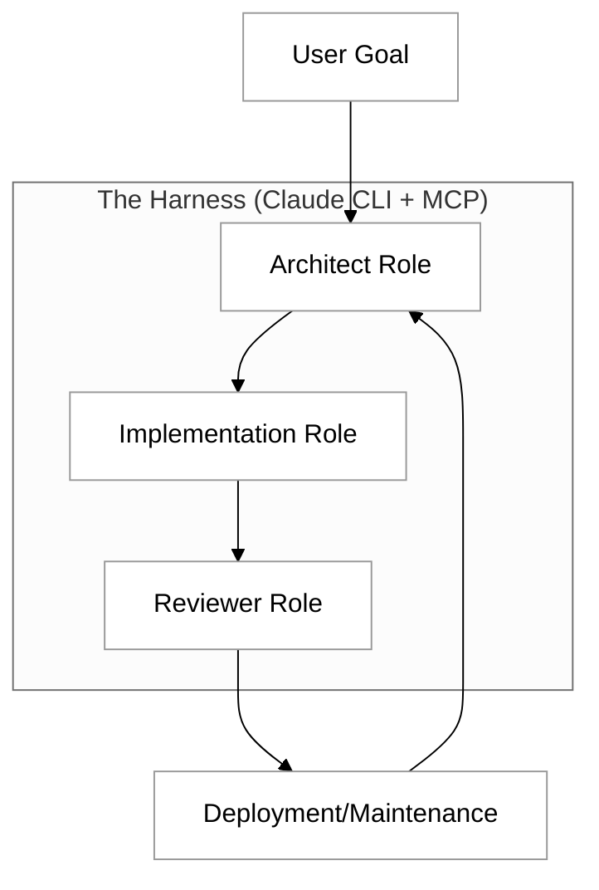

# Claude crew

In the evolution of agentic programming, we move beyond simple chat interfaces into structured environments where Large Language Models (LLMs) act as autonomous operators. A "Claude Crew" isn't just a collection of prompts; it is a specialized harness—a software framework—built around the Claude CLI that allows the model to interact with your local file system, run build commands, and iterate on a codebase. By leveraging the Model Context Protocol (MCP), we can transform Claude from a passive advisor into an active member of a development team capable of designing, building, and maintaining complex web applications.

Building a harness requires a shift in mindset. Instead of asking Claude to "write a script," we provide it with a set of tools and a structured workflow. This workflow mimics a professional software development lifecycle (SDLC), where different "personae" or specialized system prompts handle architectural decisions, feature implementation, and quality assurance.

## The Architecture of an Agentic Harness

A functional harness consists of three primary layers: the **Execution Environment** (the CLI and your local file system), the **Tool Layer** (MCP servers providing file access and shell execution), and the **Orchestration Layer** (the system prompts and logic that define how Claude behaves).

When using the Claude CLI, the model gains the ability to "see" your directory structure and "act" by writing code directly to files. To make this a "crew," we define specific roles that Claude can cycle through during the project lifecycle.



The Architect focuses on the `README.md` and the tech stack, the Developer focuses on the components and logic, and the Reviewer focuses on testing and bug fixes. By maintaining a strict "Harness Configuration," you ensure that the model doesn't lose track of the project scope as it grows in complexity.

## Creating the Harness: A Working Example

To create a harness, you need the Claude CLI installed and configured with MCP servers that allow file manipulation. We will create a "Project Manifest" that acts as the source of truth for our crew.

First, create a directory for your project and initialize a harness configuration file. This file tells any Claude session exactly what its boundaries and tools are.

### Step 1: The Harness Configuration (`harness.json`)

```json
{
  "project_name": "WebCrew_Harness",
  "roles": {
    "architect": "Design the system schema and file structure. Focus on scalability.",
    "developer": "Write clean, modular React and Tailwind CSS code. Follow the design spec.",
    "maintainer": "Monitor for errors, optimize performance, and refactor code."
  },
  "tools_enabled": ["filesystem", "sequentialthinker", "fetch"],
  "rules": [
    "Always check existing files before creating new ones.",
    "Every component must have a corresponding test file.",
    "Use descriptive commit-like messages when saving changes."
  ]
}
```

### Step 2: Initializing via the CLI

You can start the crew by piping this context into the Claude CLI. This command initializes the "Architect" persona to begin the project setup.

```bash
claude "I am starting a new project. Use the rules in harness.json to act as the Architect. 
Initialize a Next.js project in the current directory and map out the file structure."
```

By using the `sequentialthinker` tool, Claude will pause to plan the file structure before writing any code. This prevents the "hallucination of logic" that often occurs when models rush into coding without an architectural map.

## Demonstration: Building "ProfBalance"

To demonstrate the power of this harness, we will use it to create **ProfBalance**, a website designed to rate professors. Unlike traditional rating sites that often devolve into venting platforms, ProfBalance uses an "Honest, Open, and Balanced" framework. 

### The Architect's Design

The Architect persona identifies that to ensure balance, the UI must require users to provide both a "Strength" and an "Area for Growth" for every rating. It also designs a "Contextual Difficulty" metric that weighs ratings based on the course's objective complexity.

**CLI Command:**
`claude "As the Architect, create a database schema for ProfBalance that supports balanced reviews and a Next.js frontend structure."`

### The Developer's Implementation

The Developer persona takes the schema and builds the submission form. It uses the harness rules to ensure that the "Submit" button remains disabled until both positive and constructive feedback fields are populated with a minimum character count.

```typescript
// ProfBalance Review Component Fragment
export default function BalancedReviewForm() {
  return (
    <form className="space-y-4">
      <div>
        <label>Academic Rigor (1-5)</label>
        <input type="range" min="1" max="5" />
      </div>
      <div>
        <label>Primary Strength (Required)</label>
        <textarea placeholder="What did this professor excel at?" required />
      </div>
      <div>
        <label>Constructive Feedback (Required)</label>
        <textarea placeholder="What could be improved for future students?" required />
      </div>
    </form>
  );
}
```

### The Maintainer's Enhancement

Once the site is built, we switch to the Maintainer role. We might ask Claude to:
`claude "Analyze the existing ProfBalance components. Implement a sentiment analysis check that flags reviews containing purely inflammatory language without specific examples."`

Through the CLI, the Maintainer reads the files, identifies the `ReviewForm.tsx`, and integrates a validation layer—all while staying within the constraints defined in our initial `harness.json`.

## Common Challenges and Solutions

Operating a website through an agentic crew presents unique challenges compared to traditional development.

*   **Context Window Drift:** As the codebase grows, Claude may forget earlier architectural decisions. 
    *   *Solution:* Maintain a `docs/` folder within your project that contains a "Project Map." Force the "Crew" to read this map at the start of every session using the CLI.
*   **Tool Permission Fatigue:** Constant prompts for permission to write files can break the flow.
    *   *Solution:* Use the CLI's "auto-approve" or "trusted directory" settings (if available and safe) or group tasks so that Claude writes multiple related files in one logical block.
*   **Recursive Errors:** Sometimes the model may write a bug, detect it, try to fix it, and create a new bug.
    *   *Solution:* Implement a "Reviewer" check. Before allowing the "Developer" to finalize a file, use the CLI to trigger a second Claude instance (or a fresh prompt) specifically to find flaws in the proposed code.

## Summary

The "Claude Crew" approach transforms the CLI into a collaborative workspace. By defining a structured harness with specific roles (Architect, Developer, Maintainer) and utilizing the Model Context Protocol, you can manage the entire lifecycle of a complex web project like ProfBalance. This method ensures that the final product is not just a collection of scripts, but a well-architected system that adheres to specific principles like honesty and balance. As you move forward, remember that the quality of the "crew's" output is directly proportional to the clarity of the harness you build for it.

To explore further, consider investigating the [Anthropic MCP Documentation](https://modelcontextprotocol.io/) to see how to build custom tools that allow your Claude Crew to interact with databases or external APIs directly from your terminal.