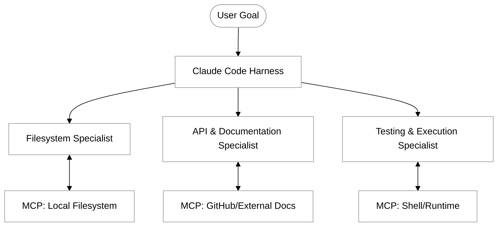

# Harnesses

In the evolution of agentic programming, we move beyond simple prompt-response interactions toward systems that can "do." A harness is the structural scaffolding that surrounds an Artificial Intelligence model, providing it with the necessary tools, permissions, and environmental context to function as an active participant in a workflow. While a single agent is powerful, the most complex real-world problems often require a "crew"—a collection of specialized agentic processes working in concert. 

A harness acts as the interface between the LLM's reasoning engine and the external world. It defines the boundaries of what an agent can see and touch. When we talk about "harnessing" Claude Code or similar agentic tools, we are discussing how to transition from a chatbot that talks about code to an autonomous system that can navigate a file system, execute tests, and interact with web services to achieve a high-level goal.

## The Concept of a Crew

In a multi-agent system, a "crew" represents a collaborative environment where different agentic instances (or specialized tool-sets) are assigned specific roles. Rather than asking a single LLM instance to be an expert in database optimization, frontend styling, and security auditing all at once, we utilize harnesses to partition these responsibilities.

This modular approach mimics human software teams. By using a harness to define specific scopes, we reduce the "noise" in the model's context window. Each part of the crew focuses on a subset of the problem, leading to higher precision and fewer hallucinations. In this module, we explore how Claude Code serves as a primary harness that can orchestrate these diverse capabilities through the Model Context Protocol (MCP).

## Harnessing Claude Code

Claude Code is a command-line interface (CLI) that serves as a highly specialized harness for Anthropic’s models. It provides a pre-built environment where the model has immediate, agentic access to your local development environment. 

When you initialize Claude Code in a directory, you aren't just opening a chat; you are creating a harness that includes:
*   **File System Access:** The ability to read, write, and search through your codebase.
*   **Command Execution:** The power to run builds, tests, and linters.
*   **Contextual Awareness:** A mechanism to index your files and understand the project structure.

By using Claude Code, you are essentially operating a "Lead Engineer" agent. This agent can then use other tools (via MCP) to act as a "crew," pulling in data from specialized servers to complete tasks that go beyond mere text generation.

## Operating as a Crew with MCP

The Model Context Protocol (MCP) is the glue that allows a harness to expand its crew. If Claude Code is the orchestrator, MCP servers are the specialized team members. For example, you can connect Claude Code to a Google Maps MCP server, a Slack MCP server, and a Postgres MCP server simultaneously.

### Practical Example: The Documentation and Deployment Crew

Imagine you need to update a React component based on a new design specification located in a remote Notion database, and then notify the team on Slack once the local tests pass. A single agent might struggle with the sheer variety of API calls and authentication logic required. 

In a harnessed environment using Claude Code, the process looks like this:

1.  **The Research Agent (MCP Notion Server):** Claude uses the Notion tool to fetch the design specs.
2.  **The Developer Agent (Claude Code Core):** Claude analyzes the local files, modifies the React component, and saves the changes.
3.  **The QA Agent (Shell Tool):** Claude executes `npm test` within the harness to verify the changes.
4.  **The Communications Agent (MCP Slack Server):** Upon success, Claude uses the Slack tool to post a summary of the changes to the `#dev-updates` channel.

By providing these tools through the harness, you allow the model to switch "modes" or "roles" fluidly, operating as a multi-functional crew.

## Designing Effective Harnesses

To create a successful harness for your agents, you must focus on three pillars:

*   **Permissions and Safety:** A harness must define what an agent is *allowed* to do. In Claude Code, this often involves "Approved Commands" or restricted directories. Safety is paramount when agents have the power to delete files or spend money via APIs.
*   **State Management:** The harness must keep track of what has been done. If one "crew member" fails, the harness should provide the orchestrator with the error logs so it can attempt a "self-healing" loop.
*   **Information Density:** A good harness filters out irrelevant data. If an agent is searching for a bug, the harness shouldn't dump the entire 1GB log file into the prompt; it should provide tools to grep or tail the logs.

## Challenges in Multi-Agent Orchestration

Operating multiple agents or complex toolsets within a harness introduces specific challenges:

*   **Context Fragmentation:** As more tools are added, the "instructions" for how to use those tools take up more of the model's limited memory (context window). 
    *   *Solution:* Use specialized MCP servers that only expose the most necessary functions, rather than every possible API endpoint.
*   **Looping and Deadlocks:** Two agents (or two tools) might get stuck in a loop where one waits for the output of another that never arrives.
    *   *Solution:* Implement "maximum turn" limits in your harness to force a stop and request human intervention if a task isn't resolved in 10-15 steps.
*   **Tool Choice Paralysis:** If a harness provides 50 different tools, the model may struggle to pick the most efficient one.
    *   *Solution:* Group tools into logical "kits" and only provide the kit relevant to the current phase of the task (e.g., a "Testing Kit" vs. a "Deployment Kit").

## Summary

Harnesses transform LLMs from passive observers into active participants. By utilizing Claude Code as a primary harness and expanding its capabilities via the Model Context Protocol, developers can move from single-turn interactions to "crew-based" workflows. This approach allows for greater specialization, improved error handling, and the ability to tackle complex, multi-stage engineering problems. As you build your own agentic systems, remember that the strength of the agent is often determined by the quality of the harness that supports it.

For further exploration of the tools available for your crew, refer to the [Anthropic MCP Documentation](https://modelcontextprotocol.io) and the [Claude Code CLI Guide](https://docs.anthropic.com/en/docs/agents-and-tools/claude-code).