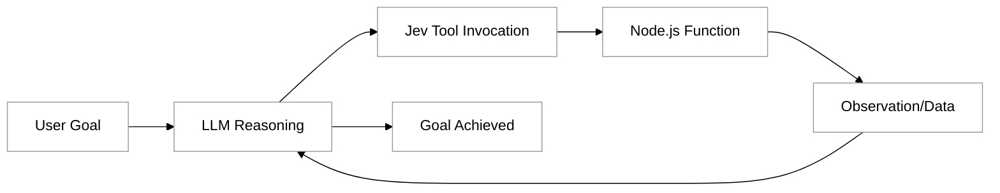

# Jev Quickstart

In the landscape of agentic programming, the ability to translate high-level reasoning into concrete actions is what separates a simple chatbot from an autonomous agent. Jev is a lightweight, type-safe framework designed to facilitate this translation by leveraging the Model Context Protocol (MCP). It allows developers to build agents that interact with their environment through a structured loop of planning, acting, and observing.

By using Node.js as your implementation language, you can tap into a massive ecosystem of libraries to create tools that your Large Language Model (LLM) can use to solve complex tasks. This guide will walk you through setting up Jev, defining your first tool, and running an agent that can interact with the physical or digital world.

## The Architecture of a Jev Agent

Before writing code, it is helpful to understand how Jev facilitates the interaction between an LLM and your local environment. Jev acts as a runtime that manages the communication between the model's reasoning and your tool definitions.



This loop continues until the LLM determines that the goal has been met. Jev ensures that the tools you provide are described accurately to the LLM using standard JSON schemas, which are automatically generated from your TypeScript types.

## Prerequisites

To follow this tutorial, ensure you have the following installed on your machine:

*   **Node.js**: Version 18 or higher.
*   **npm or yarn**: For managing dependencies.
*   **An API Key**: Typically from Anthropic (Claude), as Jev is optimized for models that excel at tool-calling.

Set your API key in your environment:
```bash
export ANTHROPIC_API_KEY='your-api-key-here'
```

## Initializing Your Project

Start by creating a new directory for your project and initializing a Node.js environment. We will use TypeScript to take full advantage of Jev's type-safety features.

```bash
mkdir my-jev-agent
cd my-jev-agent
npm init -y
npm install @typesafe-ai/jev typescript ts-node @types/node
npx tsc --init
```

Once your environment is ready, create a file named `index.ts`. This will serve as the entry point for your agent.

## Defining Your First Tool

A "tool" in Jev is simply a standard JavaScript function that includes a description. This description is vital because it tells the LLM when and how to use the function.

In this example, we will create a tool that allows the agent to fetch the current weather for a specific city. While simple, this demonstrates the core concept: connecting the LLM to an external data source.

```typescript
import { tool } from "@typesafe-ai/jev";

/**
 * Fetches the current weather for a given city.
 */
export const getWeather = tool(
  async ({ city }: { city: string }) => {
    // In a real scenario, you would call an API like OpenWeatherMap
    console.log(`--- Executing Tool: getWeather for ${city} ---`);
    
    // Mock data for demonstration
    const mockWeather = {
      "San Francisco": "72°F, Sunny",
      "London": "15°C, Rainy",
      "Tokyo": "22°C, Cloudy"
    };

    return mockWeather[city as keyof typeof mockWeather] || "Weather data not found for this city.";
  },
  {
    name: "get_weather",
    description: "Get the current weather for a specific city",
  }
);
```

Notice how the `tool` wrapper takes both the implementation and a metadata object. Jev uses this metadata to build the tool definition that is sent to the LLM.

## Building the Agent Loop

Now that we have a tool, we need to provide it to the Jev runtime and give the agent a task. Jev simplifies the orchestration of the LLM call and the subsequent tool execution.

```typescript
import { Jev } from "@typesafe-ai/jev";

async function runAgent() {
  const jev = new Jev({
    model: "claude-3-5-sonnet-latest",
    tools: [getWeather]
  });

  const response = await jev.run({
    instruction: "Check the weather in London and tell me if I should bring an umbrella."
  });

  console.log("Agent Response:", response.content);
}

runAgent().catch(console.error);
```

When you run this script using `npx ts-node index.ts`, the following happens:
1.  The agent receives your instruction.
2.  It realizes it needs weather information and identifies the `get_weather` tool.
3.  Jev executes the function locally.
4.  The result ("15°C, Rainy") is fed back to the LLM.
5.  The LLM generates the final response: "Yes, you should bring an umbrella because it is currently rainy in London."

## Type Safety and the Model Context Protocol

One of the primary benefits of using Jev with Node.js is its integration with the Model Context Protocol (MCP). MCP provides a standardized way for agents to discover and use tools across different environments. 

Because Jev is "typesafe," it automatically handles the conversion of your TypeScript interfaces into the JSON Schema format required by MCP. If you change a parameter name in your code, the schema sent to the LLM updates automatically, preventing the common "hallucination" where a model tries to call a function with arguments that no longer exist.

## Common Challenges and Solutions

While building with Jev, you might encounter a few common hurdles:

*   **Complex Nested Arguments**: LLMs occasionally struggle with deeply nested JSON structures.
    *   *Solution*: Keep your tool inputs flat when possible. Instead of passing a complex "User" object, pass a `userId` string.
*   **Error Handling**: If a tool fails (e.g., a network timeout), the agent needs to know why.
    *   *Solution*: Wrap your tool logic in `try/catch` blocks and return a descriptive error message. Jev will pass this error message back to the LLM, which can then attempt to fix the problem or explain it to the user.
*   **Rate Limiting**: LLM APIs have strict limits.
    *   *Solution*: Use the built-in observability features in Jev to monitor how many calls the agent is making in a single loop.

## Summary

The Jev Quickstart provides a streamlined path toward building functional AI agents using Node.js. By combining the reasoning capabilities of high-end LLMs with the structured execution of the Model Context Protocol, you can create systems that do more than just talk—they act. 

Key takeaways from this tutorial include:
*   **Jev** acts as a bridge between LLM reasoning and local code execution.
*   **Tools** are simple Node.js functions wrapped with metadata that Jev converts into schemas.
*   **The Agent Loop** is a cycle of instruction, tool selection, execution, and observation.
*   **Type Safety** is your best defense against runtime errors and model hallucinations.

For further exploration, consider looking into the [Typesafe AI Documentation](https://docs.typesafe.ai/) to learn about advanced orchestration techniques and how to deploy your Jev agents as standalone MCP servers.