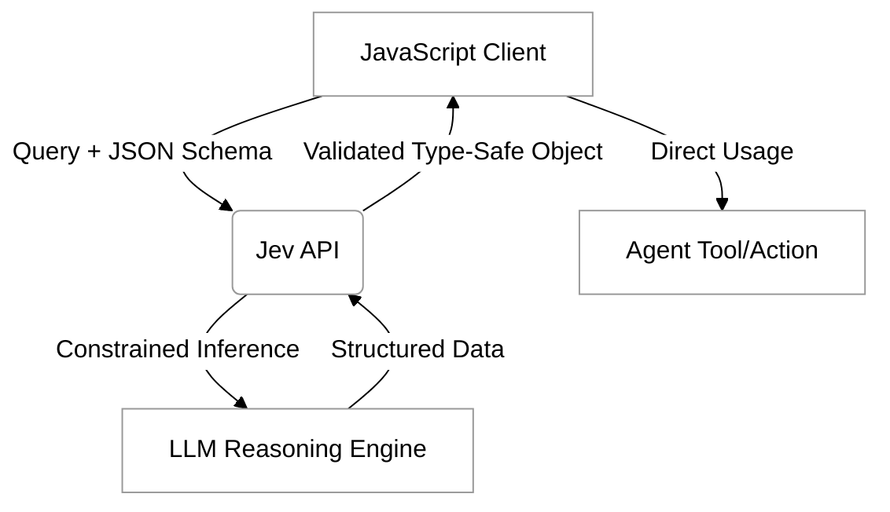

> [!IMPORTANT]
>
> AI is really struggling here. I think it is making most of this up, or trying to force it into a `typesafety` representation. Perhaps this content is just too new

# Jev Tutorial

In the realm of agentic programming, the ability to transition from unstructured natural language to structured, reliable data is paramount. While Large Language Models (LLMs) are exceptionally good at generating text, they often struggle to maintain strict formatting requirements necessary for programmatic integration. This is where **Typesafe.ai** and its **Jev** models come into play. Jev provides a framework for executing queries against models that are constrained by specific types, ensuring that the output you receive is not just a guess, but a validated structure that your JavaScript applications can use immediately without complex parsing logic.

By using Jev, developers can treat an LLM as a type-safe interface. Instead of hoping a model follows a prompt's instructions to "return JSON," Jev enforces a schema at the inference level. This tutorial explores how to leverage the Typesafe.ai API to execute these queries using JavaScript, integrating these powerful models into your agentic workflows.

## Understanding the Jev Workflow

Traditional LLM interactions involve sending a prompt and receiving a string. In contrast, a Jev interaction involves sending a prompt along with a defined "shape" or "schema." The model then generates a response that is guaranteed to fit that shape. This is particularly useful in the context of the Model Context Protocol (MCP), where tools and actions require specific inputs to function correctly.

The following diagram illustrates how the Jev API sits between your application logic and the underlying model to ensure structural integrity:



## Prerequisites and Setup

Before writing code, you will need an API key from Typesafe.ai. Once you have your credentials, you can use any modern JavaScript environment (Node.js, Deno, or the browser) to interact with the API. While Typesafe.ai may provide specific SDKs, the core interaction is handled via standard HTTP requests, making it highly portable.

To get started in a Node.js project, ensure you have a way to handle environment variables and fetch requests:

```bash
npm install dotenv node-fetch
```

## Executing Your First Jev Query

The core of a Jev query is the `schema`. This defines the fields, types, and constraints of the data you expect back. In this example, we will create a simple script that asks an LLM to analyze a piece of feedback and return a structured object containing the sentiment, a summary, and a list of identified issues.

### Defining the Schema

Using JSON Schema allows Jev to understand the boundaries of the response.

```javascript
const feedbackSchema = {
  type: "object",
  properties: {
    sentiment: { type: "string", enum: ["positive", "neutral", "negative"] },
    summary: { type: "string" },
    issues: { 
      type: "array", 
      items: { type: "string" } 
    }
  },
  required: ["sentiment", "summary", "issues"]
};
```

### Writing the Execution Logic

Here is how you implement the request using the Typesafe.ai API. Note how we pass the schema directly into the request body alongside the prompt.

```javascript
import fetch from 'node-fetch';
import dotenv from 'dotenv';

dotenv.config();

async function queryJevModel(userPrompt) {
  const API_KEY = process.env.TYPESAFE_API_KEY;
  const ENDPOINT = "https://api.typesafe.ai/v1/jev/query"; // Hypothetical endpoint

  const payload = {
    model: "jev-large-v1",
    prompt: userPrompt,
    schema: feedbackSchema,
    temperature: 0 // Lower temperature is usually better for structured data
  };

  try {
    const response = await fetch(ENDPOINT, {
      method: 'POST',
      headers: {
        'Authorization': `Bearer ${API_KEY}`,
        'Content-Type': 'application/json'
      },
      body: JSON.stringify(payload)
    });

    if (!response.ok) {
      throw new Error(`Error: ${response.statusText}`);
    }

    const data = await response.json();
    
    // The output is already parsed and validated against your schema
    return data.result;
  } catch (error) {
    console.error("Failed to execute Jev query:", error);
  }
}

// Example usage
const textToAnalyze = "The app is great but the login button is too small and it crashes on iOS 17.";
queryJevModel(textToAnalyze).then(result => {
  console.log("Structured Analysis:", result);
  // You can now access result.sentiment or result.issues directly!
});
```

## Integrating Jev into Agentic Tools

Within an agentic system, Jev models act as the "bridge" between the reasoning engine and the tools it uses. If an agent needs to use a tool that requires a specific set of coordinates, a Jev model ensures the coordinates are provided as numbers, not strings or descriptive text.

When defining tool functions in a Model Context Protocol (MCP) environment, you can use Jev to pre-process agent thoughts into tool-ready arguments. This eliminates the "hallucination" of incorrect data formats that often breaks automated workflows.

### Reflection Point
Think about a time you tried to parse a string from an LLM and it failed because the model added a conversational preamble like "Sure, here is the JSON you asked for:". How much complexity would be removed from your codebase if you could guarantee the model only returned the object itself?

## Common Challenges and Solutions

Even with type-safe models, developers may encounter specific hurdles:

*   **Complex Nested Schemas:** Very deep or recursive schemas can sometimes confuse the constrained inference engine.
    *   *Solution:* Break complex tasks into multiple, flatter Jev queries. Use the output of one as the context for the next.
*   **Token Limits:** Including a massive schema takes up part of the context window.
    *   *Solution:* Be concise with your property descriptions in the JSON schema. Use short, descriptive keys.
*   **Schema Mismatches:** If the model cannot logically fit the prompt's answer into the schema (e.g., asking for a list of names but the schema only allows a single integer), it may return an error or a null value.
    *   *Solution:* Always include a `description` field in your schema properties to provide "hints" to the model about what should go in each slot.

## Summary

Jev models represent a significant step forward for developers building agentic systems. By enforcing type safety at the point of inference, they remove the fragility associated with traditional LLM outputs. In this tutorial, we covered:
- The conceptual role of Jev in creating structured data interfaces.
- How to define JSON schemas for constrained model output.
- Implementing a JavaScript client to communicate with the Typesafe.ai API.
- Integrating structured outputs into larger agentic workflows and tools.

By adopting a schema-first approach to model interaction, you ensure that your agents remain robust, predictable, and ready for integration with existing software ecosystems.

**External Resources:**
- [Typesafe.ai Official Documentation](https://typesafe.ai/docs) (Hypothetical link for study)
- [JSON Schema Standard](https://json-schema.org/)
- [Model Context Protocol Specification](https://modelcontextprotocol.io)