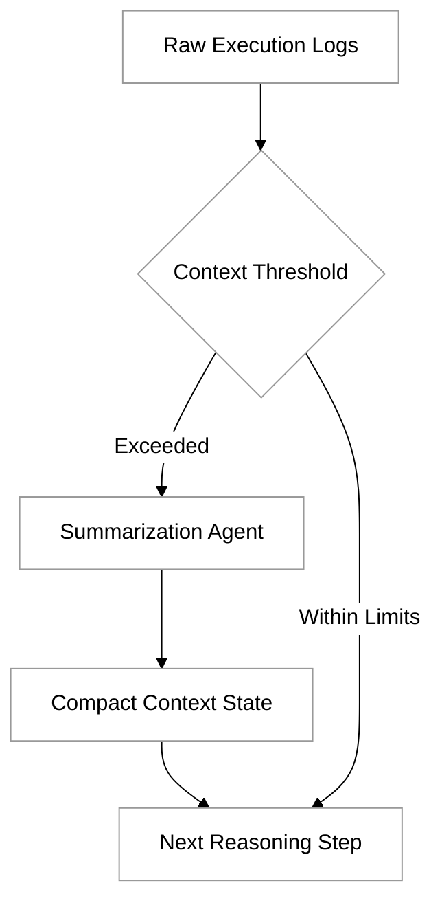

# Setting up your dev environment

The transition from traditional software development to agentic programming requires a fundamental shift in how we view our development environment. In a standard setup, the environment is a passive collection of tools for a human to use. In an agentic setup, the environment is a workspace where an LLM—specifically Claude—acts as an autonomous participant. Setting up your environment correctly means providing Claude with the right permissions, context, and "sensory" inputs (via the Model Context Protocol) to execute tasks, verify its own work, and collaborate with other specialized agents.

### Core Configuration and Claude Code

The primary interface for this workflow is often the Claude CLI or a dedicated agentic harness. Unlike a simple chat interface, the Claude Code environment needs to be configured to interact with your local file system, execute terminal commands, and access network resources. 

Initial configuration involves setting up your API keys and defining the safety boundaries for the agent. When you first initialize the environment, you create a profile that dictates how much autonomy the agent has. For example, you can set "auto-approve" levels for read-only commands while requiring manual intervention for destructive actions like deleting files or pushing to production branches.

### Achieving Environment Portability

A common challenge in agentic development is "it works on my machine" syndrome, which is exacerbated when an agent relies on specific local tools. To ensure your configuration is portable across team members or CI/CD pipelines, you should treat your agent’s configuration as code.

1.  **Configuration Files**: Store agent behaviors, allowed toolsets, and project-specific instructions in a `.claude` or `agent.json` file at the root of your repository.
2.  **Environment Variables**: Use `.env` files to manage API endpoints and keys, ensuring the agent knows where to find MCP servers without hardcoding paths.
3.  **Containerization**: The most robust way to ensure portability is to wrap the entire development environment in a Docker container. This ensures that the agent always has access to the exact versions of compilers, runtimes, and CLI tools it needs to succeed.

### Storing, Updating, and Compacting Context

Agents generate a vast amount of metadata, logs, and intermediate thoughts. If you pass all of this back to the model in every turn, you will quickly hit token limits and increase latency. Managing this "context drift" is vital.

**Storage**: Use a dedicated directory (e.g., `.claude/context/`) to store long-term project summaries and successful patterns. This acts as the agent's "long-term memory."

**Compaction**: As a conversation or task progresses, the context grows. Periodically, you or the agent should perform a "Compaction Step." This involves summarizing the work completed so far, the current state of the system, and the remaining goals, then discarding the granular history of every minor command.

### Empowering Agents with Skills

In the context of Claude Code, "Skills" are reusable scripts or complex command sequences that you teach the agent. Instead of telling the agent to "find all instances of this variable and replace them, then run tests," you can define a "Refactor" skill. 

Defining a skill involves:
*   **The Script**: A Python or Bash script that performs the heavy lifting.
*   **The Description**: A natural language explanation of what the skill does, which Claude uses to decide when to invoke it.
*   **The Schema**: A definition of the arguments the skill accepts.

By building a library of skills, you reduce the "reasoning overhead" for the model, allowing it to focus on high-level logic while delegating repetitive tasks to reliable scripts.

### Integrating the Model Context Protocol (MCP)

The Model Context Protocol (MCP) is the standard that allows Claude to connect to external data sources and tools seamlessly. In your dev environment, you will likely use several MCP servers simultaneously.

For example, you might have:
*   A **Filesystem MCP** for secure file operations.
*   A **GitHub MCP** for managing issues and pull requests.
*   A **Database MCP** to allow the agent to query a development database to understand the data schema.

To set this up, you configure your host (Claude Code) to point to the executable of these servers. This creates a "hub-and-spoke" model where the agent sits at the center, reaching out to specialized servers for specific capabilities.

### Executing and Coordinating Multiple Agents

Complex software tasks often exceed the capability of a single agent instance. Setting up your environment for multi-agent coordination involves defining "Handoff Protocols."

In a multi-agent setup, you might have a **Manager Agent** that decomposes a feature request into sub-tasks. It then spawns a **Coder Agent** to write the implementation and a **Reviewer Agent** to check for bugs. 

Coordination is handled through:
*   **Shared Workspace**: All agents operate on the same file tree but use file-locking or specific branching strategies to avoid conflicts.
*   **Message Bus**: A structured way for agents to "talk" to each other, often implemented as a shared JSON log or a specialized task-tracking tool.

### Verifying Correctness

The final and most important part of the environment is the verification loop. You should never assume an agent’s output is correct. Your environment must be configured to automatically run validation suites.

1.  **Test-Driven Development (TDD)**: Instruct your agent to write a test case *before* writing the implementation. The environment should be configured to run these tests automatically.
2.  **Linting and Static Analysis**: Integrate tools like ESLint, Pylint, or MyPy. The agent should be configured to run these tools after every file modification and self-correct if errors are found.
3.  **The "Check" Step**: Before finishing a task, the agent should execute a `verify` command that runs the full build and test pipeline.

### Common Challenges and Solutions

*   **Token Exhaustion**: Large codebases can easily overwhelm the model. 
    *   *Solution*: Use `.gitignore`-like files (e.g., `.claudeignore`) to prevent the agent from reading node_modules, build artifacts, or large data files.
*   **Permission Issues**: Agents might fail because they don't have the right to execute a binary.
    *   *Solution*: Ensure the user running the Claude CLI has the necessary sudo or execution permissions, or use a containerized environment where permissions are pre-set.
*   **Recursive Loops**: Sometimes agents get stuck trying the same failing command repeatedly.
    *   *Solution*: Implement a "max turns" limit in your configuration to force the agent to stop and ask for human help if it can't solve a problem in, say, 10 attempts.

### Summary

Setting up a development environment for Claude Code is about creating a structured, safe, and highly observable workspace. By focusing on configuration portability, efficient context management via compaction, and robust tool integration through MCP, you create an environment where agentic systems can thrive. Remember that the goal is to build a "closed-loop" system where the agent plans, acts, and—crucially—verifies its own work against your project's standards.

For further exploration, look into the [Model Context Protocol documentation](https://modelcontextprotocol.io) and explore the [Claude CLI repository](https://github.com/anthropics/claude-code) for specific configuration flags and community-built skills.