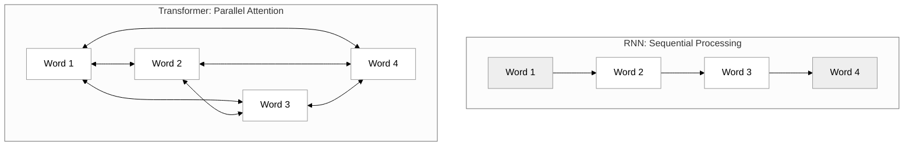

# Transformers

In the landscape of modern artificial intelligence, the Transformer architecture stands as the foundational pillar upon which Large Language Models (LLMs) are built. Before we can master how agents use tools or interact via the Model Context Protocol, we must understand the engine that makes "reasoning" and "decision-making" possible. The Transformer shifted the paradigm of machine learning from processing data as a sequence of steps to processing data as a holistic web of relationships. This shift is what allows a model like Claude or GPT-4 to maintain the "context" necessary to plan a complex workflow or select the correct tool for a specific task.

### The Evolution from Recurrent Neural Networks

To appreciate the Transformer, we must first look at what came before: Recurrent Neural Networks (RNNs) and their more advanced cousin, the Long Short-Term Memory (LSTM) network.

RNNs were designed to handle sequential data, such as sentences or time series. They processed information word by word, from left to right. As the network moved from the first word to the second, it carried a "hidden state"—a sort of mental summary—of everything it had seen so far. While this sounds logical, it suffered from two critical flaws:

1.  **The Vanishing Gradient Problem:** As sequences got longer, the information from the beginning of the sentence would "fade away." By the time an RNN reached the end of a long paragraph, it would often "forget" the subject introduced at the start.
2.  **Sequential Bottlenecks:** Because each word depended on the hidden state of the previous word, RNNs could not be easily parallelized. You couldn't process the end of a sentence until you finished the middle, making training on massive datasets agonizingly slow.

### The Transformer Breakthrough: Attention is All You Need

In 2017, researchers at Google published a paper titled "Attention is All You Need," introducing the Transformer. This architecture abandoned recurrence entirely in favor of a mechanism called **Self-Attention**. 

Instead of reading a sentence one word at a time, a Transformer looks at every word in a sequence simultaneously. It treats a block of text not as a chain, but as a map where every word can "attend" to every other word to determine its meaning.

### How Self-Attention Works

Imagine you encounter the word "bank" in a sentence. Is it a river bank or a financial institution? To know, you look at the surrounding words. If you see "water" and "flow," you know it's a river. If you see "interest" and "deposit," it's a financial bank.

The Transformer does this mathematically through three vectors for every token (word or sub-word):
*   **Query:** What am I looking for?
*   **Key:** What information do I contain?
*   **Value:** If I am relevant, what information do I contribute?

By calculating the "score" between the Query of one word and the Keys of all other words, the model determines how much "attention" to pay to each part of the input. This allows the model to capture long-range dependencies—linking a pronoun at the end of a document to a noun at the very beginning with ease.

### Positional Encodings

Because Transformers process all words at once, they technically lose the sense of word order. To solve this, developers add "Positional Encodings" to the input embeddings. These are unique mathematical signals added to each word’s vector that tell the model exactly where that word sits in the sequence. This ensures the model knows the difference between "The dog chased the cat" and "The cat chased the dog."

### Why Transformers are Essential for Agentic Systems

In the context of agentic programming and the Model Context Protocol (MCP), the Transformer’s architecture provides several non-negotiable benefits:

*   **Complex Tool Schemas:** When an agent looks at a list of available tools, it must understand the intricate JSON schemas defining those tools. The Transformer's ability to relate different parts of a schema (like a parameter name to its description) allows it to select the right tool with high precision.
*   **Long-Term Planning:** Agents often operate in loops (Planning -> Action -> Observation). The Transformer can hold the entire history of these steps in its "context window," allowing it to remember that an error in Step 2 requires a change in strategy for Step 5.
*   **Few-Shot Learning:** Transformers are excellent at pattern matching. By providing a few examples of how to use a tool within the prompt, the Transformer can generalize that behavior to new, unseen tasks.

### Common Challenges and Solutions

Despite their power, Transformers face specific limitations that developers must navigate:

*   **Quadratic Scaling:** The computational cost of the original Transformer grows quadratically with the length of the input. This is why "context windows" (the amount of text a model can "read" at once) are limited. 
    *   *Solution:* Use Retrieval-Augmented Generation (RAG) to only feed the most relevant information into the model, keeping the context window lean.
*   **Hallucination:** Because Transformers are essentially predicting the next most likely token, they can confidently state falsehoods if they lack specific data.
    *   *Solution:* Implementing the Model Context Protocol allows the model to query "ground truth" data sources via tools, grounding its reasoning in reality rather than just probability.

### Further Exploration

To dive deeper into the mathematical mechanics of Transformers, the following resources are highly recommended:
*   [The Illustrated Transformer by Jay Alammar](https://jalammar.github.io/illustrated-transformer/): A visual guide that breaks down the math of attention.
*   [Attention Is All You Need (Original Paper)](https://arxiv.org/abs/1706.03762): The foundational research paper for the curious developer.

### Summary

The transition from RNNs to Transformers represents the jump from simple sequence processing to deep contextual understanding. By utilizing self-attention and parallel processing, Transformers overcome the memory limitations of previous architectures. For us as agentic programmers, the Transformer is the "brain" that allows our systems to parse tool definitions, follow complex multi-step instructions, and maintain the coherence necessary to solve high-level goals autonomously. Understanding this foundation is the first step in building agents that don't just follow scripts, but actually reason through problems.