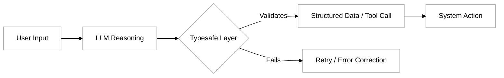

# Typesafe ai

In the evolution of software development, we have transitioned from manual punch cards to high-level programming languages that offer safety and predictability. However, the rise of Large Language Models (LLMs) introduced a "fuzzy" element into our tech stacks. Traditional LLM interactions are inherently unstructured; you send a string of text and receive a string of text back. While this is excellent for creative writing, it is problematic for agentic systems that need to execute code, call APIs, or navigate complex workflows.

Typesafe AI is the methodology of bringing the rigor of type systems—common in languages like TypeScript, Rust, or Python (via Pydantic)—to the world of generative AI. It ensures that the model’s outputs adhere to a strict, predefined schema. Instead of hoping the model mentions a date in its response, Typesafe AI forces the model to return a structured object where the date is a validated field. This bridge between natural language and structured data is what allows LLMs to function as reliable reasoning engines in autonomous systems.

### The Core Concept: Moving Beyond the Text Blob

Traditional LLM usage follows a "Prompt-to-Prose" pattern. You ask a question, and the model responds with a paragraph. To use that information in an application, developers often resort to "regexing" (regular expression matching) or complex string parsing to find the specific data points they need. This is fragile; if the model changes its phrasing or adds an introductory sentence, the parser breaks.

Typesafe AI flips this script by treating the LLM as a function that returns a specific data structure. By defining a schema—often using JSON Schema or language-specific tools like Zod or Pydantic—the developer creates a "contract" with the model. The model is instructed not just to answer, but to populate an instance of that schema.



### How Typesafe AI Works

Typesafe AI relies on several technical mechanisms to ensure the model follows the rules. It is rarely a single prompt; rather, it is a combination of engineering techniques and model features.

*   **Schema Enforcement:** Developers define the expected output format using a schema. For example, a "Search Query" tool might require a `query` string and a `limit` integer. 
*   **Function Calling and Tool Use:** Modern models (like Claude 3.5 or GPT-4o) have been fine-tuned to recognize tool definitions. When a model sees a tool schema, it understands it must generate a JSON object that matches those specific keys and types.
*   **Constrained Decoding:** Some frameworks ensure type safety at the inference level. They restrict the model's vocabulary at each token step, essentially "turning off" the ability for the model to generate a character that would violate the JSON structure.
*   **Validation and Self-Correction:** If a model produces an output that fails validation (e.g., a string where a number was expected), a typesafe system catches the error and automatically re-prompts the model with the validation error, asking it to fix the output.

### Differences from Traditional LLM Interactions

The shift to Typesafe AI is fundamental for building agentic systems. Here is how it differs from standard text-based interactions:

| Feature | Traditional LLM | Typesafe AI |
| :--- | :--- | :--- |
| **Output Format** | Unstructured String (Markdown/Text) | Structured Object (JSON/Class) |
| **Predictability** | Low (Varies per prompt) | High (Guaranteed schema) |
| **Integration** | Requires manual parsing/regex | Directly injectable into code/APIs |
| **Error Handling** | Subjective human review | Automated validation logic |
| **Primary Use** | Chatbots, Content Creation | Agents, Tool Use, Data Extraction |

### The Role of Types in Agentic Systems and MCP

In the context of this module, Typesafe AI is the foundation of the **Model Context Protocol (MCP)** and tool-based actions. An agent cannot interact with the "real world" unless it can speak the language of APIs. 

APIs are rigid. If an API expects a UUID and the LLM provides "the same ID as before," the call fails. Typesafe AI ensures that when an agent decides to take an action—such as searching a database or sending an email—the parameters it generates are exactly what the external tool requires. This "Contract-Driven Development" for AI ensures that the **Observation** phase of the agentic loop receives clean, actionable data rather than error messages.

### Practical Example: The Email Router

Imagine you are building an agent to handle customer support emails. A traditional LLM might summarize the email. A Typesafe AI agent will categorize it into a specific enum and extract priority as an integer.

**The Schema (using a TypeScript-like definition):**
```typescript
interface SupportTicket {
  category: "Billing" | "Technical" | "General";
  priority: 1 | 2 | 3 | 4 | 5;
  requires_human: boolean;
  summary: string;
}
```

When the LLM processes an email about a broken login, it doesn't just say "The user is upset." It returns:
```json
{
  "category": "Technical",
  "priority": 1,
  "requires_human": true,
  "summary": "User unable to access dashboard via Chrome."
}
```
The application can now automatically route this JSON object to a high-priority technical support queue without any human intervention or "fuzzy" logic.

### Common Challenges and Solutions

Even with type safety, working with LLMs presents unique hurdles:

*   **Hallucinated Types:** The model might invent a new category not present in your enum.
    *   *Solution:* Use validation libraries (like Instructor or Zod) to check the output and pass the error back to the model for a "retry" attempt.
*   **Schema Complexity:** If the schema is too deeply nested or complex, the model’s reasoning performance may degrade.
    *   *Solution:* Keep tool schemas flat and descriptive. Use the `description` field in your JSON Schema to explain *why* a field is needed and what it represents.
*   **Model Limitations:** Older or smaller models struggle with strict JSON adherence.
    *   *Solution:* Use models specifically optimized for tool use and function calling, and ensure your system prompt emphasizes that only JSON is permitted.

### Summary

Typesafe AI is the bridge that allows us to treat Large Language Models as reliable components in a software architecture. By moving from unstructured text to validated, schema-bound data, we enable LLMs to act as "reasoning modules" that can safely trigger tools, interact with APIs via the Model Context Protocol, and participate in complex agentic workflows. It transforms the LLM from a conversational partner into a precise utility capable of driving autonomous systems.

To explore further, consider looking into the following resources:
- [The Instructor Library (Python/JS)](https://github.com/jxnl/instructor) - A popular tool for structured data extraction.
- [JSON Schema Documentation](https://json-schema.org/) - The standard used by most LLMs for tool definitions.
- [Pydantic](https://docs.pydantic.dev/) - Data validation for Python, frequently used in AI agents.