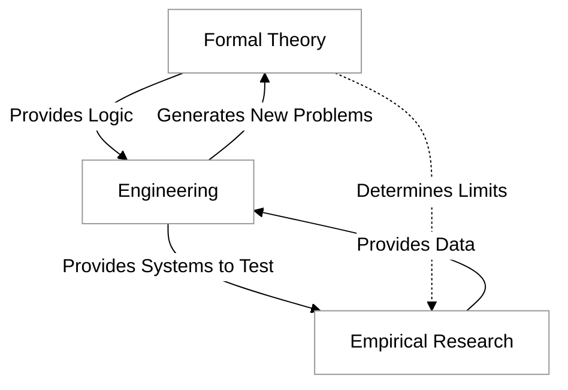

# What is Computer Science

While we often interact with computers as physical objects—sleek laptops, powerful servers, or mobile devices—computer science is not merely the study of these machines. A physical computer is the material device that carries out computation. Its circuits change electrical states in ways that implement instructions, but using a computer to accomplish a task does not, by itself, make that task scientific. Just as using a microscope doesn't make every activity involving it science, using a computer to write an email or browse the web is a matter of utility, not a scientific pursuit.

Computer science is the rigorous study of computation, information, and automation. It explores the nature of what can be calculated and the most efficient ways to achieve those results. To understand this field, we must distinguish between the abstract logic of computation and the physical hardware that makes that logic manifest in the real world. In the context of agentic programming, where we build autonomous systems that use Large Language Models (LLMs) as reasoning engines, this distinction becomes even more critical. We are no longer just writing scripts; we are designing systems that must navigate formal logic, empirical performance, and engineering constraints simultaneously.

## The Three Pillars of Computer Science

To grasp the breadth of computer science, we can categorize the work into three distinct but overlapping domains: formal theory, empirical research, and engineering.

### Formal Theory

Formal theory is the mathematical heart of the field. It involves proving that an algorithm gives the correct answer or determining which problems are even capable of being solved by a computer. These results are derived from mathematical reasoning rather than physical measurement.

For instance, a computer scientist might use formal logic to prove that a sorting algorithm will always order a list correctly, regardless of the input size. They might also define the complexity of an algorithm using Big O notation, such as `O(n log n)`, to describe how its resource requirements grow. This theoretical work provides the foundational "rules of the game" that all software must follow.

### Empirical Research

Empirical research shifts the focus from what is "provable" to what is "observable." This involves measuring how algorithms or systems perform in the real world, testing how humans interact with software, or investigating the reliability and security of a network.

If the formal theory tells us that an algorithm is correct, empirical research tells us how it behaves under stress. Researchers might run benchmarks to measure how many milliseconds a process takes on a specific CPU architecture or use statistical analysis to determine if a new security protocol effectively thwarts attacks. In the realm of agentic programming, empirical research is vital for evaluating how different LLM prompts or "Chain-of-Thought" techniques impact the success rate of an autonomous agent.

### Engineering

Engineering is the practical application of theory and research. It involves designing and building hardware or software that functions under real-world constraints such as speed, cost, memory, and power consumption.

An engineer takes the proven sorting algorithm (Theory) and the performance data (Empirical Research) to build a production-grade database system. In this stage, the developer must make trade-offs. For example, they might choose a slightly slower algorithm because it uses less memory, which is a critical constraint for the specific device being used.

## The Role of the Physical Device

The physical device acts as the bridge between abstract computation and the tangible world. It is the medium that "makes a procedure happen." Without the physical circuits to switch states, an algorithm is just a set of mathematical ideas.

When we consider agentic systems, the physical computer (or the cloud infrastructure it resides on) provides the "body" for the agent's "mind." The agent might use a reasoning loop—Plan, Act, Observe—to achieve a goal. While the "Planning" phase involves formal logic and language processing, the "Action" phase often involves interacting with the physical world or digital environments through the Model Context Protocol (MCP) or API calls.

For example:
- **Theory:** A proof shows that a sorting algorithm correctly orders a list.
- **Empirical Research:** Benchmarks measure how quickly that algorithm runs on a specific ARM-based processor.
- **Engineering:** A developer builds a student grade management app that implements this algorithm.
- **Agentic Application:** An autonomous agent is tasked with "Improving student performance." It decides to use the grade management app to identify failing students and then drafts personalized tutoring plans for them.

## Computer Science and the Scientific Method

Under a measurement-centered definition of science, certain parts of computer science fit the "science" label more naturally than others. Empirical research, with its focus on observation and experimentation, aligns closely with the natural sciences like physics or biology.

However, the theoretical branches of computer science are often categorized as "formal sciences," much like mathematics or logic. They do not rely on the physical world for validation. A proof remains true even if no computer ever runs it.

This dual nature is what makes computer science unique. It requires the rigor of a mathematician, the curiosity of a researcher, and the pragmatism of an engineer.

## Challenges in Defining the Field

One of the primary challenges for students is confusing the "tool" with the "science." It is common to believe that learning a specific programming language, like Python or Java, is the same as learning computer science.

In reality, a programming language is a tool for expressing computation, much like a brush is a tool for painting. The science lies in understanding the composition, the physics of color, and the perspective.

Common misconceptions include:
- **Challenge:** Thinking computer science is just "coding."
- **Solution:** Focus on the underlying concepts—data structures, algorithms, and system architecture—which remain constant regardless of the language used.
- **Challenge:** Overlooking hardware constraints in software design.
- **Solution:** Study the "Engineering" pillar to understand how memory management and CPU cycles affect the feasibility of an agent's reasoning loop.

## Summary

Computer science is a multifaceted discipline that connects abstract mathematical concepts to physical reality through engineering and empirical observation. It is defined by three main types of work: formal theory (logical proofs), empirical research (performance measurement), and engineering (building within constraints).

As we move into the study of Agentic Programming, remember that an "agent" is an implementation of these principles. Whether an agent is decomposing a task via Chain-of-Thought reasoning or interacting with external data via Retrieval-Augmented Generation (RAG), it is operating within the framework of computer science. Understanding the distinction between the device, the procedure, and the science allows us to build more robust, efficient, and autonomous systems.

### Further Reading
- *Introduction to the Theory of Computation* by Michael Sipser
- *The Art of Computer Programming* by Donald Knuth
- ACM/IEEE Computer Science Curricula Guidelines