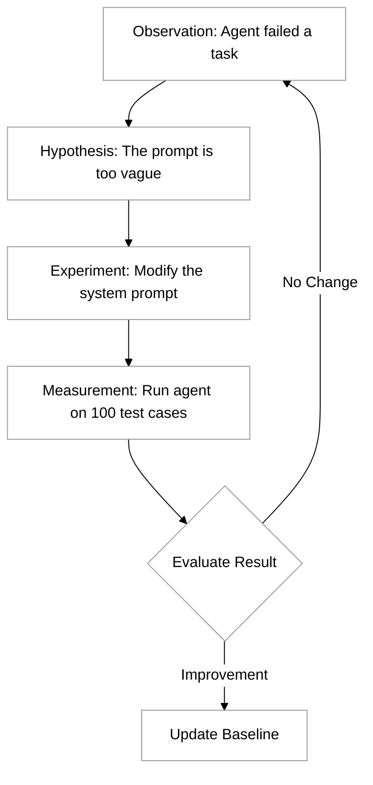
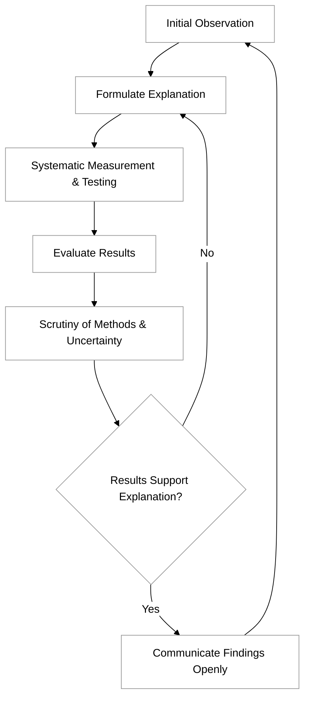
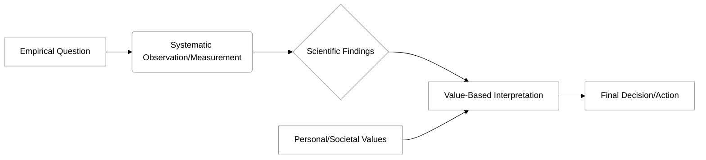

# What is Science?

Science is frequently misunderstood as a static collection of facts found in textbooks. However, in the context of advanced technology and agentic programming, science is better understood as a verb: a disciplined process of inquiry. It is the systematic use of observation and measurement to evaluate explanations about how a system behaves. By making methods transparent and acknowledging uncertainty, science allows us to move from guessing how a system works to understanding it with a measurable degree of confidence.

In the world of traditional software engineering, we often operate under the "construction" metaphor—we build a bridge according to rigid specifications. But as we move into the realm of Large Language Models (LLMs) and autonomous agents, we find ourselves dealing with systems that are non-deterministic and complex. Here, the engineer must become a scientist. We cannot simply "code" a solution; we must observe the model’s behavior, form hypotheses about why it responds in certain ways, and conduct experiments to refine its performance.

## The Foundations of Scientific Inquiry

The heart of science lies in the transition from subjective opinion to objective evaluation. This process relies on three primary pillars that are as applicable to a chemistry lab as they are to a prompt engineering workspace.

### Systematic Observation

Observation in science is not casual; it is structured. It involves documenting what happens under specific conditions without letting personal bias interfere. In agentic programming, this equates to logging. When an agent fails to complete a task, a scientific approach requires us to look at the "traces"—the step-by-step thoughts and actions the agent took—to see exactly where the logic diverged from the goal.

### Measurement and Quantifiable Evaluation

An explanation is only as good as our ability to test it. Science requires us to move from "the agent seems better" to "the agent has a `92%` success rate on this specific benchmark." Measurement allows us to compare two different versions of a system (such as two different system prompts or two different LLM backends) and determine which one is truly superior based on data rather than intuition.

### Scrutiny and Transparency

For an observation to be "scientific," it must be reproducible. This means the methods used to reach a conclusion must be open to scrutiny. If a developer claims an agent is "autonomous," they must provide the logs, the prompt templates, and the evaluation metrics used. This transparency ensures that others can verify the results and that "uncertainty"—the margin of error inherent in all complex systems—is clearly communicated.

## The Scientific Cycle in Agentic Systems

In agentic programming, we utilize a cycle that mirrors the classic scientific method. This cycle is what allows an agent to improve its own performance through the "Plan, Act, Observe" loop.



This loop is the engine of progress. In agentic systems, we often call this "Evaluation-Driven Development." We treat our code not as a set of instructions, but as a hypothesis that must survive the "scrutiny" of a rigorous test suite.

## The Role of Falsifiability

A key concept in science is falsifiability. For a theory or an explanation to be scientific, there must be a way to prove it wrong. If you say, "the AI is just being temperamental today," you are not being scientific, because there is no way to test or disprove "temperament."

However, if you say, "the AI is failing because the input context exceeds `8192` tokens," you have made a scientific claim. You can measure the token count, observe the failure rate, and prove whether your explanation is correct or false. Building agentic systems requires us to constantly look for these falsifiable explanations to solve complex bugs.

## Practical Example: Prompt Engineering as Science

Imagine you are building a travel agent. You notice that sometimes it suggests flights that are out of the user's budget.

*   **Non-Scientific Approach:** You feel frustrated and add "Please be careful about the budget!!!" in all caps to the prompt. You run it once, it works, and you assume the problem is solved.
*   **Scientific Approach:** You identify the specific "uncertainty" in the agent's behavior. You create a dataset of `n = 50` budget scenarios. You hypothesize that providing the budget as a JSON object rather than plain text will improve accuracy. You run the agent through the dataset, measure the deviation from the budget, and compare the `mean_error` of the old prompt versus the new one.

The scientific approach is slower initially, but it builds a foundation of knowledge that allows you to scale the agent with confidence.

## Common Challenges and Solutions

Treating programming as a science presents unique hurdles, especially when dealing with the stochastic (random) nature of LLMs.

**Challenge: The Stochasticity Problem**
LLMs do not always give the same output for the same input. This makes "measurement" difficult because a single test run might be a fluke.
*   **Solution:** Use statistical significance. Instead of running a test once, run it `k` times (e.g., `k = 20`) and calculate the average performance. Treat the LLM's output as a probability distribution rather than a single fixed point.

**Challenge: Bias in Observation**
Developers often fall in love with their own code and overlook failures, focusing only on the "happy path" where the agent succeeds.
*   **Solution:** Automated "Evaluators." Use a second, highly capable LLM (like GPT-4o or Claude 3.5 Sonnet) or a set of hard-coded assertions to act as an objective judge of the first agent's performance.


## Putting Science into Practice

Applying science is the active transition from idle curiosity to disciplined inquiry. It involves moving beyond anecdotal evidence—"I saw this happen once"—to systematic data collection. When we apply science, we don't just look for evidence that supports our ideas; we actively design measurements that could potentially prove us wrong. This rigor ensures that our explanations are built on a foundation of repeatable facts rather than subjective impressions.

The process of application follows a cyclical path where observations lead to explanations, which are then tested through specific, measurable criteria. A critical part of this application is the acknowledgment of **uncertainty**. No measurement is perfect, and no scientific explanation is immune to revision. By quantifying how much we *don't* know (the margin of error), we actually make our findings more reliable and useful for others.



### The Role of Scrutiny and Transparency

In professional scientific application, "showing your work" is as important as the result itself. This transparency allows the global community to scrutinize the methods used. If a method is flawed, the explanation it supports must be re-evaluated. This is why scientists document their experimental steps and the limitations of their tools. 

For example, consider a software engineer applying scientific principles to debug a complex system. Instead of changing code randomly, they use a disciplined process:

1.  **Systematic Observation:** Log the exact inputs that cause a crash.
2.  **Measurement:** Record memory usage and CPU spikes during the crash.
3.  **Evaluation:** Compare the data against the expected performance model.
4.  **Scrutiny:** Share the logs and the reproduction steps with the team to ensure the fix isn't based on a false assumption.

```python
# Example of applying measurement and uncertainty in code
def measure_performance(runtime_seconds):
    # A single measurement isn't enough for a 'scientific' application
    # We must account for environmental noise (uncertainty)
    margin_of_error = 0.05 
    
    print(f"Recorded Runtime: {runtime_seconds}s")
    print(f"Confidence Interval: {runtime_seconds * (1 - margin_of_error)}s to {runtime_seconds * (1 + margin_of_error)}s")
    
    # Transparency involves stating the limitations of this measurement
    print("Method: Wall-clock time recorded on a shared server; background tasks may affect results.")
```

By following these steps, the engineer isn't just "fixing a bug"—they are applying a scientific framework to ensure the solution is robust and understood by others.

```masteryls
{"id":"59f25a5e-064e-42d5-b67a-3bd5244882c4","title":"The Core of Scientific Application","type":"multiple-choice"}
Why is it essential to make methods and uncertainty open to scrutiny when applying science to a problem?

- [ ] To prove that the explanation is 100% certain and can never be changed.
  You might think science aims for absolute certainty, but it actually thrives on refinement. We share methods so others can find errors or improve our ideas, not to claim they are unchangeable.
- [x] To allow others to evaluate the validity of the process and identify potential errors.
  Correct! Science is a disciplined process. By being transparent about how we measured data and where our uncertainties lie, we allow the community to verify our work and ensure the explanation holds up under pressure.
- [ ] To ensure that only people with the same opinion can see the data.
  Actually, science requires the opposite! We open our methods to everyone, especially those who might disagree, to ensure that the explanation survives rigorous, unbiased testing.
- [ ] To hide the weaknesses of the experiment from the public.
  This is incorrect. Applying science requires honesty about uncertainty. Highlighting the limitations of a study is a hallmark of good science because it prevents others from over-interpreting the results.
```


## Science as a Tool, Not a Title

Science is often misunderstood as a label for a specific profession or a list of established facts. In reality, science is better understood as a disciplined **process** for investigating empirical questions—those that can be answered through observation and measurement. Many professional fields use scientific methods to inform their work, but those fields also involve human elements like ethics, aesthetics, and personal values that fall outside the realm of scientific measurement.

### Empirical Questions vs. Value Judgments

A "scientific" approach can tell us what *is* happening or what *tends* to happen under certain conditions. However, it cannot tell us what we *should* do with that information. This distinction is critical in applied fields. For example, a doctor uses science to understand the success rate of a surgery, but the decision to proceed depends on the patient's personal values regarding quality of life and risk.

The following table illustrates how different fields leverage science to address specific questions while relying on other frameworks for judgment:

| Field | Scientific Questions (Empirical) | Judgment & Values (Non-Scientific) |
| :--- | :--- | :--- |
| **Medicine** | Does this drug lower blood pressure? What are the side effects? | Is the benefit worth the risk for this specific patient? |
| **Politics** | How will this tax policy affect GDP or employment rates? | Which segment of society should we prioritize helping? |
| **Business** | Which advertisement design leads to more clicks? | What kind of brand identity and ethics should we project? |
| **News** | Can this source's claim be verified by video or documents? | Which stories are "important" enough to be on the front page? |
| **Art** | Which pigments degrade fastest when exposed to UV light? | Is this painting beautiful, provocative, or meaningful? |

### The Workflow of Evidence-Based Practice

In many "evidence-based" professions, science acts as a foundational input, but the final output requires a human decision-maker to interpret the data through a lens of values.



### Example: Science in Business

Consider a business owner deciding whether to change their website's checkout process. They can use science (via an A/B test) to gather data, but the ultimate decision involves risk tolerance and long-term strategy.

```python
# A simplified "Scientific" evaluation of a business change
def calculate_conversion_rate(visitors, sales):
    """Provides a measurement of performance (Scientific)."""
    return (sales / visitors) * 100

control_group = calculate_conversion_rate(1000, 50)  # 5.0%
variant_group = calculate_conversion_rate(1000, 55)  # 5.5%

# THE SCIENCE: The variant performed 0.5% better in this test.
# THE JUDGMENT: Is a 0.5% gain worth the $10,000 cost of re-coding the site?
# Science provides the 0.5% figure; the owner provides the decision.
```

By recognizing that science is a way to investigate specific questions rather than a badge of absolute authority for an entire field, we can better appreciate its power while respecting the role of human judgment.

```masteryls
{"id":"3f480cf1-f69a-47e4-bf52-601d61267cb4","title":"Distinguishing Science from Judgment","type":"multiple-choice"}
A city council is reviewing a proposal for a new public park. Which of the following questions can be addressed using the scientific method?

- [ ] Whether the park is more "beautiful" than the parking lot it replaces.
  You chose an aesthetic judgment. While you can survey people's opinions, "beauty" is a subjective value and cannot be measured as an objective physical property. Science can tell us what people prefer, but it cannot define what is inherently beautiful.
- [x] How many degrees the local temperature drops in the area due to the new trees.
  Correct! This is an empirical question that can be answered through systematic measurement and observation of physical data. It is a classic example of using science to understand the physical effects of an action.
- [ ] Whether the city "should" prioritize green space over affordable housing.
  This is a question of societal values and priorities. While science can provide data on the effects of both green space and housing, it cannot decide which one a society ought to value more.
- [ ] Whether the park is a "worthy" investment of taxpayer money.
  This involves a value judgment regarding "worth" and fiscal priorities. Science can calculate the cost and the projected usage, but the definition of "worthy" depends on the values of the stakeholders.
```


## Summary

Science is the disciplined practice of evaluating explanations through systematic observation and measurement. In the context of Agentic Programming, adopting a scientific mindset is essential for managing the inherent uncertainty of Large Language Models. By forming falsifiable hypotheses, conducting rigorous experiments, and subjecting our agents to open scrutiny through benchmarking, we transform unpredictable "black boxes" into reliable, autonomous systems. As you progress through this module, remember that every "bug" is an opportunity for an experiment, and every "success" is a hypothesis waiting to be measured.