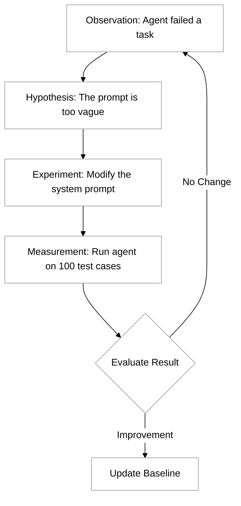

# What is Science?

Science is frequently misunderstood as a static collection of facts found in textbooks. However, in the context of advanced technology and agentic programming, science is better understood as a verb: a disciplined process of inquiry. It is the systematic use of observation and measurement to evaluate explanations about how a system behaves. By making methods transparent and acknowledging uncertainty, science allows us to move from guessing how a system works to understanding it with a measurable degree of confidence.

In the world of traditional software engineering, we often operate under the "construction" metaphor—we build a bridge according to rigid specifications. But as we move into the realm of Large Language Models (LLMs) and autonomous agents, we find ourselves dealing with systems that are non-deterministic and complex. Here, the engineer must become a scientist. We cannot simply "code" a solution; we must observe the model’s behavior, form hypotheses about why it responds in certain ways, and conduct experiments to refine its performance.

## The Foundations of Scientific Inquiry

The heart of science lies in the transition from subjective opinion to objective evaluation. This process relies on three primary pillars that are as applicable to a chemistry lab as they are to a prompt engineering workspace.

### Systematic Observation

Observation in science is not casual; it is structured. It involves documenting what happens under specific conditions without letting personal bias interfere. In agentic programming, this equates to logging. When an agent fails to complete a task, a scientific approach requires us to look at the "traces"—the step-by-step thoughts and actions the agent took—to see exactly where the logic diverged from the goal.

### Measurement and Quantifiable Evaluation

An explanation is only as good as our ability to test it. Science requires us to move from "the agent seems better" to "the agent has a `92%` success rate on this specific benchmark." Measurement allows us to compare two different versions of a system (such as two different system prompts or two different LLM backends) and determine which one is truly superior based on data rather than intuition.

### Scrutiny and Transparency

For an observation to be "scientific," it must be reproducible. This means the methods used to reach a conclusion must be open to scrutiny. If a developer claims an agent is "autonomous," they must provide the logs, the prompt templates, and the evaluation metrics used. This transparency ensures that others can verify the results and that "uncertainty"—the margin of error inherent in all complex systems—is clearly communicated.

## The Scientific Cycle in Agentic Systems

In agentic programming, we utilize a cycle that mirrors the classic scientific method. This cycle is what allows an agent to improve its own performance through the "Plan, Act, Observe" loop.

This loop is the engine of progress. In agentic systems, we often call this "Evaluation-Driven Development." We treat our code not as a set of instructions, but as a hypothesis that must survive the "scrutiny" of a rigorous test suite.

## The Role of Falsifiability

A key concept in science is falsifiability. For a theory or an explanation to be scientific, there must be a way to prove it wrong. If you say, "the AI is just being temperamental today," you are not being scientific, because there is no way to test or disprove "temperament."

However, if you say, "the AI is failing because the input context exceeds `8192` tokens," you have made a scientific claim. You can measure the token count, observe the failure rate, and prove whether your explanation is correct or false. Building agentic systems requires us to constantly look for these falsifiable explanations to solve complex bugs.

## Practical Example: Prompt Engineering as Science

Imagine you are building a travel agent. You notice that sometimes it suggests flights that are out of the user's budget.

*   **Non-Scientific Approach:** You feel frustrated and add "Please be careful about the budget!!!" in all caps to the prompt. You run it once, it works, and you assume the problem is solved.
*   **Scientific Approach:** You identify the specific "uncertainty" in the agent's behavior. You create a dataset of `n = 50` budget scenarios. You hypothesize that providing the budget as a JSON object rather than plain text will improve accuracy. You run the agent through the dataset, measure the deviation from the budget, and compare the `mean_error` of the old prompt versus the new one.

The scientific approach is slower initially, but it builds a foundation of knowledge that allows you to scale the agent with confidence.

## Common Challenges and Solutions

Treating programming as a science presents unique hurdles, especially when dealing with the stochastic (random) nature of LLMs.

**Challenge: The Stochasticity Problem**
LLMs do not always give the same output for the same input. This makes "measurement" difficult because a single test run might be a fluke.
*   **Solution:** Use statistical significance. Instead of running a test once, run it `k` times (e.g., `k = 20`) and calculate the average performance. Treat the LLM's output as a probability distribution rather than a single fixed point.

**Challenge: Bias in Observation**
Developers often fall in love with their own code and overlook failures, focusing only on the "happy path" where the agent succeeds.
*   **Solution:** Automated "Evaluators." Use a second, highly capable LLM (like GPT-4o or Claude 3.5 Sonnet) or a set of hard-coded assertions to act as an objective judge of the first agent's performance.

## Summary

Science is the disciplined practice of evaluating explanations through systematic observation and measurement. In the context of Agentic Programming, adopting a scientific mindset is essential for managing the inherent uncertainty of Large Language Models. By forming falsifiable hypotheses, conducting rigorous experiments, and subjecting our agents to open scrutiny through benchmarking, we transform unpredictable "black boxes" into reliable, autonomous systems. As you progress through this module, remember that every "bug" is an opportunity for an experiment, and every "success" is a hypothesis waiting to be measured.